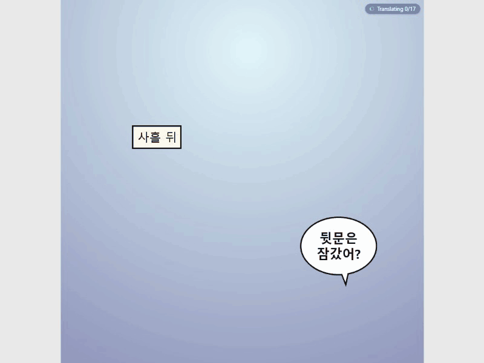
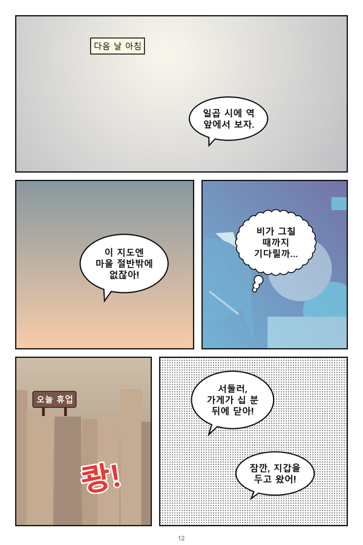
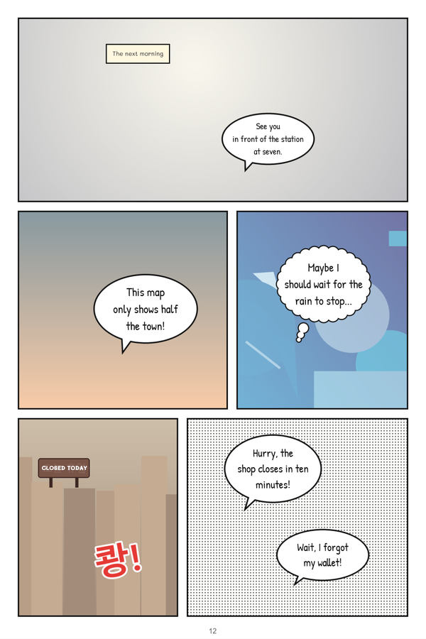
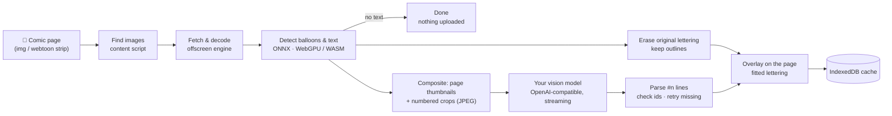

<div align="center">


# Panelingo

**Read any comic, manga or webtoon in your language, right where it is.**<br>
On-device text detection · clean erasing that keeps balloon outlines · size-matched lettering · any OpenAI-compatible vision model

[](https://github.com/ducdt1298/panelingo/actions/workflows/ci.yml)
[](https://github.com/ducdt1298/panelingo/actions/workflows/codeql.yml)
[](LICENSE)
[](https://developer.chrome.com/docs/extensions/develop/migrate/what-is-mv3)
[](tsconfig.base.json)
[](https://github.com/ducdt1298/panelingo/stargazers)

[Install](#quick-start) · [How it works](#how-it-works) · [Providers](#supported-providers) · [Configuration](docs/CONFIGURATION.md) · [FAQ](#faq) · [Roadmap](docs/ROADMAP.md) · [Contributing](CONTRIBUTING.md)

<!-- Generated from synthetic fixtures by e2e/docs-shots.ts (see docs/images/README.md). -->


</div>

---

Panelingo is a Chrome extension that translates comics **in place, while you read**:

- A text detector **running on your device** finds the speech balloons and captions.
- The extension **erases the original lettering pixel by pixel**, keeping the balloon outlines and the artwork.
- It asks **the vision model of your choice** to read and translate the text.
- It draws the translation back with **lettering fitted to the balloon and sized like the original**.

It works on long-strip webtoons and paged manga alike, it caches everything so re-opened chapters are instant, and it
never sends an image that has no text in it.

<table>
  <tr>
    <td></td>
    <td></td>
  </tr>
  <tr>
    <td align="center"><sub>Before: Korean</sub></td>
    <td align="center"><sub>After: English, lettered in place</sub></td>
  </tr>
</table>

## Features

- 🔍 **On-device detection.** The [comic-text-and-bubble-detector](https://huggingface.co/ogkalu/comic-text-and-bubble-detector)
  ONNX model runs in the browser with onnxruntime-web on **WebGPU**. When WebGPU is not suitable it falls back to
  **WebAssembly**, and a built-in canary self-check makes that decision. Pages without text never leave your machine.
- 🧽 **Clean erasing that keeps balloon outlines.** The original glyphs are painted over with a model of the
  balloon's background, either a flat color or a gradient. Ink that touches the balloon outline is never erased, so
  outlines and art stay intact. Where a clean erase is not safe, for example on screentone or textured backgrounds,
  a soft translucent plate is used instead.
- ✍️ **Lettering that looks like it belongs.** Line breaks are balanced inside the balloon's ellipse, and the font size
  follows the original glyph height. The text is re-fitted on zoom and resize, set in comic hand-lettering for
  dialogue, a rounded face for captions and signs, and a bold display face for sound effects.
- 🤖 **Bring your own model.** Any OpenAI-compatible vision endpoint works: OpenAI, OpenRouter, Google Gemini (OpenAI
  mode), Azure OpenAI and gateways, or local servers such as **Ollama, LM Studio, vLLM and LiteLLM**. Presets and
  _Test connection_ are built in.
- 🧪 **Offline mode (experimental).** No endpoint at all: open-source OCR (PaddleOCR) and translation models (Opus-MT,
  or NLLB-200 for any pair) run in the browser, downloaded once from Hugging Face. Clearly below a vision model; see
  [docs/OFFLINE-MODE.md](docs/OFFLINE-MODE.md) for how it compares.
- 📜 **Made for webtoons.** Tall strips are sliced for detection, and touching images are treated as one strip, so a
  balloon split across two images is translated once. Lazy images further down are prepared before you scroll to
  them, and on-screen images jump the queue through an urgent lane.
- 🖼️ **Works on hard readers too.** Canvas-rendered or protected images that cannot be fetched are read from a screen
  capture of what you already see (only on sites you enabled, only in the visible tab).
- ⚡ **Streaming and resilient.** Balloons fill in while the model is still answering. Every line is checked
  (missing, duplicate, wrong language, refusals). Missing balloons are re-asked, and rate limits slow things down
  instead of failing.
- 🧠 **Series memory.** Names and terms stay the same across a whole series. The AI suggests new names as it
  translates; the ones it uses in several requests join the series glossary, and your own entries always win. Every
  request also carries the earlier lines of the chapter and a running story summary.
- 📝 **Transcript and glossary side panel.** Every translated line of the tab in reading order: edit a line (your edit
  always wins), translate one balloon again, jump to it on the page or copy everything. Lines that differ from the
  glossary are marked. The Glossary view lists, adds, edits, confirms and deletes entries, sets the series' source
  language and name style, and exports or imports the glossary as JSON. Open it from the popup.
- 👀 **Peek, balloon popup and progress.** Hold the backquote key to see the untouched page. Alt+click or long-press
  a balloon for its original text and full translation, with copy, edit and translate again. The toolbar icon shows
  how many images of the tab are in progress, and an orange or red "!" when something needs your attention.
- ⚙️ **Everything adjustable.** Every setting in effect is in the options page, including a per-site editor (layout,
  source language, Referer and cookie policy, reader frames) and a JSON backup and restore.
- 💾 **Instant re-reads.** Results are cached in IndexedDB by image content hash and URL. Open a chapter again and the
  translation is already there.
- 🔒 **Private by design.**
  - Translation is opt-in per site, and the extension asks before the first upload.
  - It sends only composite crops of the text regions to _your_ endpoint, never the page URL.
  - There is no telemetry and there are no servers of ours.
- 🌍 **Many languages.** Korean, Japanese, Chinese, English and Spanish sources. Translates into English,
  Vietnamese, Spanish, Brazilian Portuguese, French, German, Italian, Indonesian, Filipino, Polish, Turkish,
  Japanese, Simplified and Traditional Chinese and Korean (Japanese and Traditional Chinese lettered vertically in
  tategaki balloons). The interface itself is localized into 16 languages.

## How it works



1. The **content script** discovers comic images on sites you enabled and ranks them by distance from the viewport.
2. The **offscreen engine** reads each image, detects balloons and text locally, and builds translation units in reading
   order.
3. For each batch of balloons it renders one **Set-of-Mark composite**: downscaled pages with numbered boxes plus
   enlarged crops. It sends the composite to your model, which answers one line per balloon:
   `#3|dialogue|Speaker|original|translation`.
4. Each balloon is drawn as soon as its line is accepted: the erase patch first, then the fitted lettering, inside a
   shadow root over the original image.

Want the details? Read [docs/ARCHITECTURE.md](docs/ARCHITECTURE.md).

## Supported providers

Any endpoint that implements the OpenAI **Chat Completions** API with **streaming** and **image input** works. The
model must accept images.

| Provider                    | Base URL                                                  | Example model                 | API key  |
| --------------------------- | --------------------------------------------------------- | ----------------------------- | -------- |
| OpenAI                      | `https://api.openai.com/v1`                               | `gpt-4o-mini` (default)       | Yes      |
| OpenRouter                  | `https://openrouter.ai/api/v1`                            | `openai/gpt-4o-mini`          | Yes      |
| Google Gemini (OpenAI mode) | `https://generativelanguage.googleapis.com/v1beta/openai` | `gemini-2.5-flash`            | Yes      |
| Azure OpenAI (v1 API)       | `https://YOUR-RESOURCE.openai.azure.com/openai/v1`        | your deployment name          | Yes      |
| Ollama (local)              | `http://127.0.0.1:11434/v1`                               | `qwen2.5vl:7b`                | No       |
| LM Studio (local)           | `http://127.0.0.1:1234/v1`                                | any loaded vision model       | No       |
| vLLM (local)                | `http://127.0.0.1:8000/v1`                                | `Qwen/Qwen2.5-VL-7B-Instruct` | Optional |
| LiteLLM proxy               | `http://127.0.0.1:4000/v1`                                | any routed vision model       | Optional |

Larger hosted models follow the output format most reliably. Small local models work but miss more balloons. Setup
notes for every provider, including local servers and Chrome's Local Network Access, are in
[docs/CONFIGURATION.md](docs/CONFIGURATION.md#providers).

## Quick start

### Install

**Chrome Web Store.** Coming soon.

**From a release.** Download `panelingo-x.y.z.zip` from the
[latest release](https://github.com/ducdt1298/panelingo/releases/latest) and unzip it. In
`chrome://extensions`, enable **Developer mode**, click **Load unpacked** and select the unzipped folder.

**From source.** You need Node.js ≥ 24.19 and Chrome ≥ 148.

```sh
git clone https://github.com/ducdt1298/panelingo.git
cd panelingo
npm ci
npm run fetch-models   # downloads the detector from Hugging Face (pinned commits, SHA-256 verified)
npm run build:prod     # writes the extension to dist/
```

Then open `chrome://extensions`, enable **Developer mode**, click **Load unpacked** and select `dist/`.

### Set up and read

1. **Connect a model.** Open the extension's **Options**, pick a preset (or enter any base URL), paste your API key if
   the provider needs one, choose a vision model and click **Test connection**, then **Save**.
2. **Pick your languages.** "Translate into" follows your browser language by default.
3. **Turn it on for a site.** On a comic page, click the toolbar icon, then **Translate this site**. Review the privacy
   notice and confirm.
4. **Read.** Balloons are translated as you scroll. Switch the site to _Translate on request only_ if you prefer to
   trigger translation yourself.

### Keyboard shortcuts and menus

| Action                                       | Default                                      |
| -------------------------------------------- | -------------------------------------------- |
| Show or hide the translation overlay         | <kbd>Alt</kbd>+<kbd>Shift</kbd>+<kbd>Y</kbd> |
| Translate the images currently visible       | <kbd>Alt</kbd>+<kbd>Shift</kbd>+<kbd>U</kbd> |
| Turn automatic translation on/off for a site | unassigned                                   |
| Open the side panel                          | unassigned                                   |

Change or assign shortcuts at `chrome://extensions/shortcuts`. Right-click any image for **Translate this image** and
**Translate this image again**. In manual mode, hover an image and click **Translate**. Hold <kbd>`</kbd> to peek at
the original page, and <kbd>Alt</kbd>+click (or long-press) a translated balloon to open its popup.

## Configuration

The options page covers the endpoint, model, parallel requests, interface and target language, your site list, the
log level and the cache. Advanced settings include detector backend, slicing, timeouts, retries, lettering sizes,
cache retention and per-site Referer, cookie and layout policies. They are documented with defaults and limits in
[docs/CONFIGURATION.md](docs/CONFIGURATION.md).

## Privacy

- Translation runs **only on sites you enable**, or when you explicitly ask on a page.
- **Nothing is uploaded before you accept the notice** that explains what is sent.
- Only images **with detected text** are sent, as one composite JPEG per request, **to the endpoint you configured**.
  The page URL, your cookies and your browsing history are never sent to it.
- Settings, your API key and the translation cache **stay on your device**. There is **no telemetry**, no analytics
  and no server operated by this project.
- Want nothing to leave your computer? Use a local model with Ollama or LM Studio.

Full policy: [docs/PRIVACY.md](docs/PRIVACY.md).

## FAQ

<details>
<summary><b>Is it free?</b></summary>

The extension is free and open source (MIT). Translation uses the AI provider you choose, so you pay that provider's
normal API prices, or nothing if you run a local model. Each request carries one composite image for up to 12–20
balloons, depending on the model.

</details>

<details>
<summary><b>Which model should I use?</b></summary>

Start with `gpt-4o-mini` or `gemini-2.5-flash` for a good price/quality balance. Larger models (the GPT-5 family,
Gemini 2.5 Pro) read small or stylized lettering better. For fully local use, try a Qwen2.5-VL model in Ollama or LM
Studio. It is slower and makes more mistakes, but nothing leaves your machine.

</details>

<details>
<summary><b>Why does it need access to all websites?</b></summary>

Comics are served from countless domains and image CDNs. The extension needs host access to download the images you
asked to translate, to set the `Referer` header some image hosts require, and to reach whichever AI endpoint you
configure, including `127.0.0.1`. The content script still runs **only** on sites you turned on, or on a page when you
explicitly ask. Every permission is justified in [docs/PUBLISHING.md](docs/PUBLISHING.md#permission-justifications).

</details>

<details>
<summary><b>Some balloons get a soft plate instead of being erased. Why?</b></summary>

The extension erases pixel by pixel only when it is confident the result will be clean, such as a flat or gradient
background with the ink fully inside the balloon. On screentone, textured backgrounds or text overlapping art, a
translucent plate looks better than a smudge.

</details>

<details>
<summary><b>A site does not work. What can I do?</b></summary>

Standard `` readers, lazy loading, webtoon strips and Referer-protected CDNs are supported. Images drawn on
`<canvas>` or that the engine cannot fetch are read from a screen capture of the visible tab: keep the tab in front
and the image on screen while it translates. Captures do not work inside reader iframes yet, and comics set as CSS
background images are not supported (see the [roadmap](docs/ROADMAP.md)). If a reader runs inside an iframe from
another domain, add that origin to the site's reader frames in the options page (`extraFrameOrigins`,
[how](docs/CONFIGURATION.md#per-site-settings)). Otherwise, please
[open an issue](https://github.com/ducdt1298/panelingo/issues/new/choose) describing the kind of
reader.

</details>

<details>
<summary><b>My GPU is not used / detection is slow.</b></summary>

The extension uses WebGPU only if a high-performance (non-software) GPU is available and the bundled canary check
passes.
Otherwise it uses the WebAssembly int8 model on one CPU thread, which works everywhere but is slower (roughly 0.7 s
per detection pass instead of under 0.1 s). Check `chrome://gpu` to see whether WebGPU is enabled.

</details>

<details>
<summary><b>Does it work with Ollama or LM Studio?</b></summary>

Yes. Pick the preset, load a vision model and click **Test connection**. No CORS configuration is needed. If Ollama
answers _403 Forbidden_, start it with `OLLAMA_ORIGINS=chrome-extension://*`. See
[local servers](docs/CONFIGURATION.md#local-servers).

</details>

<details>
<summary><b>Where is my API key stored?</b></summary>

Locally, in the extension's storage on your device. It is not synced and is sent only to the endpoint you configured.
Use a key with a spending limit where your provider supports it.

</details>

<details>
<summary><b>Other browsers?</b></summary>

Panelingo targets Chrome 148 and newer, because it relies on structured-clone messaging, offscreen documents and
WebGPU. Other browsers are not tested yet.

</details>

## Roadmap

**Series memory**, the **transcript and glossary side panel**, the **balloon popup**, new lettering fonts,
**Japanese, Chinese and Korean targets with vertical lettering**, the **screen-capture fallback** (also inside reader
iframes), lazy-image look-ahead, the full settings UI, toolbar progress, the peek key and signed releases are done and
land in the next release. Next up: the **Chrome Web Store** listing. See [docs/ROADMAP.md](docs/ROADMAP.md).

## Contributing

Contributions are welcome: code, UI translations, provider presets, docs and site reports. Start with
[CONTRIBUTING.md](CONTRIBUTING.md), then [docs/DEVELOPMENT.md](docs/DEVELOPMENT.md) and
[docs/TESTING.md](docs/TESTING.md). Please follow the [Code of Conduct](CODE_OF_CONDUCT.md), and report security issues
privately as described in [SECURITY.md](SECURITY.md).

```sh
npm ci && npm run fetch-models
npm run check        # typecheck, lint, format, unit + integration tests with coverage
npm run test:e2e     # end-to-end tests in a real Chrome (mock AI server, synthetic fixtures)
```

## Support the project

Panelingo is built and maintained in spare time. If it makes your reading better:

- ⭐ **Star the repository.** It helps others find it.
- 💖 **Sponsor** on [GitHub Sponsors](https://github.com/sponsors/ducdt1298)
- 🗣️ **Spread the word** and share your favorite model settings in
  [Discussions](https://github.com/ducdt1298/panelingo/discussions).

<a href="https://star-history.com/#ducdt1298/panelingo&Date">
  
</a>

## License and acknowledgements

Panelingo is released under the [MIT License](LICENSE). Third-party components keep their own licenses; see
[THIRD_PARTY_NOTICES.md](THIRD_PARTY_NOTICES.md).

- **Text detector:** [comic-text-and-bubble-detector](https://huggingface.co/ogkalu/comic-text-and-bubble-detector) by
  ogkalu (Apache-2.0). The WebGPU build has its invalid shape hints stripped; see the notice.
- **Inference:** [ONNX Runtime Web](https://github.com/microsoft/onnxruntime) by Microsoft (MIT).
- **Storage:** [idb](https://github.com/jakearchibald/idb) by Jake Archibald (ISC).
- **Fonts** (SIL Open Font License 1.1), via [Fontsource](https://fontsource.org/):
  - [Patrick Hand](https://fonts.google.com/specimen/Patrick+Hand) by Patrick Wagesreiter
  - [Mali](https://fonts.google.com/specimen/Mali) by Cadson Demak
  - [Bangers](https://fonts.google.com/specimen/Bangers) by Vernon Adams
- **Prior art:** [comic-translate](https://github.com/ogkalu2/comic-translate),
  [manga-image-translator](https://github.com/zyddnys/manga-image-translator) and
  [BallonsTranslator](https://github.com/dmMaze/BallonsTranslator) pioneered many of the techniques this extension
  reimplements in the browser. This project is independent and not affiliated with them.

Please respect the rights of comic creators and publishers. Use Panelingo to read content you have access to,
and support the official releases of the series you love.
