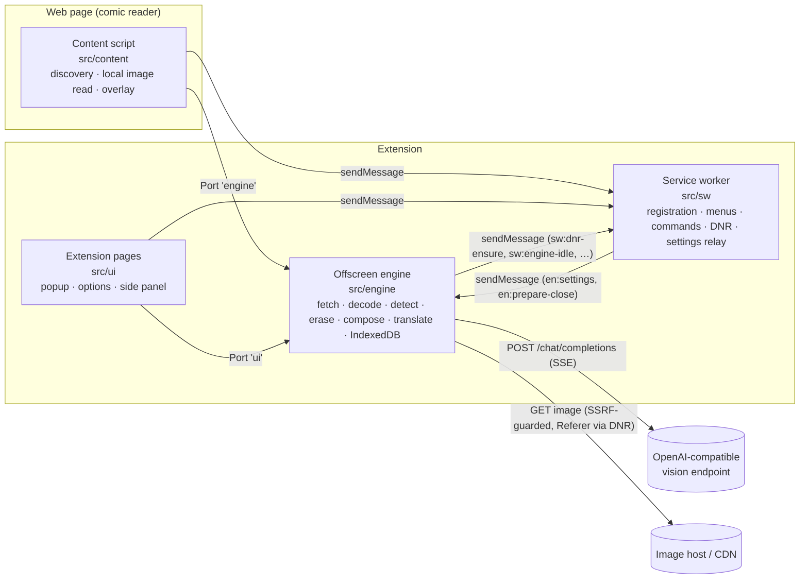

# Architecture

This document explains how Panelingo is built: which code runs where, how the pieces talk to each other, and
what happens to an image between "it scrolled into view" and "the translated lettering is on screen".

- Settings and their defaults: [CONFIGURATION.md](CONFIGURATION.md)
- Messaging rules (R1–R9): [PROTOCOL.md](PROTOCOL.md)
- Building and testing: [DEVELOPMENT.md](DEVELOPMENT.md), [TESTING.md](TESTING.md)

## Design principles

1. **Detect locally, upload as little as possible.** Text detection runs in the browser. An image without text is
   never sent anywhere. For images that do contain text, the model receives one composite JPEG per request, built
   from downscaled pages and enlarged crops of the text areas. It never receives the page URL.
2. **Any OpenAI-compatible vision endpoint.** A request is exactly `[system, user{text, image_url}]` sent to
   `POST {baseUrl}/chat/completions` with `stream: true`. It uses no tools, no assistant prefill and no
   provider-specific fields.
3. **Pure core, thin shells.** The algorithms (slicing, detection post-processing, reading order, erasing, packing,
   composite layout, prompt, SSE and line parsing, id accounting, retry policy, text fitting) live in `src/shared/**`.
   That code never touches `chrome`, the DOM or Node globals, and ESLint enforces it. Each one runs unchanged in Node
   tests and in every Chrome context.
4. **One writer.** The offscreen engine is the only context that writes IndexedDB. The service worker owns
   `chrome.storage`, declarativeNetRequest rules, menus and commands.
5. **Event-driven engine.** The engine is a hidden document, so it does not rely on chained timers or
   `requestAnimationFrame`. Work moves forward on fetch, stream and port events (see [Performance](#performance-notes)).

## Execution contexts



| Context           | Code            | Responsibilities                                                                                                                                                                                                                                                                                                                                                                                                                                                                                                                                                                                                                                                                                                                                                                                                                        |
| ----------------- | --------------- | --------------------------------------------------------------------------------------------------------------------------------------------------------------------------------------------------------------------------------------------------------------------------------------------------------------------------------------------------------------------------------------------------------------------------------------------------------------------------------------------------------------------------------------------------------------------------------------------------------------------------------------------------------------------------------------------------------------------------------------------------------------------------------------------------------------------------------------- |
| Service worker    | `src/sw/`       | It registers the content script for the sites you enabled, owns the context menu and keyboard commands, and maintains the declarativeNetRequest (DNR) session rules: the SSRF guard plus per-host Referer rules. It also relays settings changes to the engine, creates and closes the offscreen document, and runs install/update tasks. It never calls `fetch` and never listens for `runtime.onConnect`.                                                                                                                                                                                                                                                                                                                                                                                                                             |
| Offscreen engine  | `src/engine/`   | It fetches and decodes images, runs the ONNX detector, builds translation units, erase patches and composites, calls the AI endpoint, parses the stream, caches everything in IndexedDB and pushes results to content scripts and UI pages over ports. It is the only `runtime.onConnect` listener.                                                                                                                                                                                                                                                                                                                                                                                                                                                                                                                                     |
| Content script    | `src/content/`  | It finds comic images on the page, reads the ones it can read locally, reports viewport and priority, and draws the overlay: erase patches and fitted lettering inside a shadow root. It also shows the hover button, the retry button and the privacy notice card.                                                                                                                                                                                                                                                                                                                                                                                                                                                                                                                                                                     |
| Extension pages   | `src/ui/`       | Popup: endpoint status, per-site switch and mode, "translate visible images", daily upload counter. Options: endpoint presets, model, languages, sites with a per-site editor (layout, source language, Referer, cookies, subdomains, reader frames; saved through `sw:site-set`), privacy, cache, settings export and import (JSON, API key only on request), log level and a collapsed Advanced section generated from a declarative table (`src/ui/options/advanced-model.ts`) that edits every other setting in effect with the same clamping as `migrateSettings`. Side panel: the tab's transcript (edits, translate again, show on page, copy all) and the Glossary view of its series (entries by state, add, edit, confirm, delete, series settings, JSON export and import). A debug page exists in dev and test builds only. |
| Shared, pure      | `src/shared/`   | Types, settings and migrations, the message protocol, wire codec, error registry, URL guard, DNR rule builders, i18n catalogs and every algorithm in `src/shared/core/`.                                                                                                                                                                                                                                                                                                                                                                                                                                                                                                                                                                                                                                                                |
| Platform wrappers | `src/platform/` | Thin wrappers over `chrome.*` APIs: typed one-shot messaging (`onMessageFor`), typed ports (`safePost`), storage, IndexedDB schema, logging and locale detection.                                                                                                                                                                                                                                                                                                                                                                                                                                                                                                                                                                                                                                                                       |

### Why an offscreen document?

An MV3 service worker is stopped after about 30 seconds of inactivity. A single slow `fetch()` response can also get it
stopped, so it cannot reliably hold a streaming completion that may take minutes. It also has no DOM, no dynamic
`import()` and no `Worker`, which the onnxruntime-web WebAssembly path needs. An offscreen document has none of these
limits. It inherits the extension's host permissions, so its
fetches are CORS-free. It shares IndexedDB with the other extension pages, and Chrome allows exactly one per extension.
The service worker creates it with reasons `WORKERS` and `BLOBS` ("Runs the local comic text detector (WebGPU/WASM)
and decodes/re-encodes comic page images.").

## Messaging

All cross-context traffic follows the rules in [PROTOCOL.md](PROTOCOL.md). In short:

- **One-shot messages** (`chrome.runtime.sendMessage`, `chrome.tabs.sendMessage`) use the envelope
  `{ target, type, v, payload }` and the reply `{ ok: true, data } | { ok: false, error }`. The message families are
  `sw:*` (handled only by the service worker), `en:*` (only by the engine) and `cs:*` (only by content scripts).
  Every handler checks the sender against an allow-list.
- **Ports.** Content scripts open a port named `engine` and extension pages open one named `ui`, both straight to the
  offscreen engine. Results stream back over these ports as `img:state`, `img:units`, `img:unit`, `img:bulk`,
  `img:done` and `en:status`, plus `tx:delta`/`tx:reset` for the UI.
- **Codec.** The manifest opts into `message_serialization: "structured_clone"` (Chrome 148+), so `ArrayBuffer`s
  cross contexts without base64. Each hello carries a 3-byte probe buffer. If the probe does not arrive intact, the
  two sides fall back to base64. Size limits are an 8 MiB soft limit and a 32 MiB hard limit (8 MiB with base64).
- **Versioning.** Every envelope and hello carries `PROTOCOL_VERSION` from `src/shared/versions.ts`.

## Lifecycle

- **Opting in.** Sites are stored as `site:<origin>` and start disabled. When you enable a site, the service worker
  updates one dynamic content script registration (`ctv-main`, all frames, `document_idle`, isolated world, persisted
  across sessions) to cover every enabled origin. It then injects the script into the current tab right away. Other
  pages get the script only when you ask: through the context menu, a shortcut or the popup ("manual" mode).
- **Engine start.** A content script or page asks the service worker for the engine (`sw:ensure-engine`). The worker
  creates the offscreen document once and pushes `en:settings`. Inside the engine, a ready gate buffers port traffic
  while the engine boots: open IndexedDB, load the settings mirror, fetch settings from the service worker, negotiate
  the codec, run a first health check. The buffered traffic is then drained.
- **Idle close.** Closing the document is the only way to give WebAssembly memory back. The engine tracks its own
  ports and work. When it has had no ports and no queued or in-flight work for `engine.idleCloseMin` minutes, it
  sends `sw:engine-idle`. The worker then answers with `en:prepare-close` and closes the document. Separately, the
  detector session is released after `engine.detectorReleaseMin` minutes without a detection.
- **Back/forward cache and SPA readers.** A content script suspends its port when its page enters the back/forward cache and
  resumes it when the page is restored. A MutationObserver picks up images that a single-page reader swaps in. The
  port closes after `engine.portIdleMin` minutes with nothing pending.
- **Restarts.** DNR session rules are cleared when the browser restarts. The worker reinstalls them on startup, install and
  update, re-syncs the content script registration, and re-injects into open tabs of enabled sites after an update.

## Pipeline

```
 content script                              offscreen engine
 ─────────────────────────────────────       ──────────────────────────────────────────────────────────────────
 1 discovery ──img:submit──────────────────▶ 2 cache lookup ──hit──▶ replay units + translations + patches ─┐
   (img/canvas, size gate, strips,              │ miss                                                         │
    priority, viewport)                         ▼                                                              │
 3a local read (data:, blob:,              3b engine fetch (SSRF guard, DNR Referer, per-host politeness)     │
    same-origin, CORS probe) ──bytes──▶   3c screen capture (cap:prepare/cap:ready, sw:capture, crop/stitch)  │
                                             ▼                                                                 │
                                           4 decode (header pixel check, SHA-256 content key)                  │
                                             ▼                                                                 │
                                           5 detect (slice tall strips → ONNX → merge, dedupe, bubbles)        │
                                             ▼                                                                 │
                                           6 units + reading order ── no units → "no text", nothing uploaded   │
                                             ▼                                                                 │
                                           7 erase patches (mask / plate / none)                               │
                                             ▼                                                                 │
                                           8 packing + lanes (urgent lane for on-screen images)                │
                                             ▼                                                                 │
                                           9 composite JPEG (Set-of-Mark)                                      │
                                             ▼                                                                 │
                                          10 prompt ─▶ 11 stream + parse + id accounting ─▶ 12 retry ladder    │
                                             ▼                                                                 │
 13 overlay: patch + fitted lettering ◀──img:unit / img:bulk─────────────────────────────────────────────────┘
```

### 1. Discovery (content script)

`src/content/discovery.ts` watches `` and `<canvas>` elements. It uses a MutationObserver on `src`, `srcset`,
`width` and `height`, a capturing `load` listener, and an IntersectionObserver for on-screen state.

- **Size gate.** The natural short side must be at least `discovery.minNaturalSide` (300 px) and the displayed short
  side at least `discovery.minDisplayedSide` (150 px).
- **Webtoon strips.** Touching images with the same width and a vertical gap of at most `discovery.stripGapPx` are
  treated as one strip. A balloon cut in half by an image boundary is then detected as one balloon.
- **Priority.** On-screen images come first, then images below the viewport by distance, then images above it. Reading
  speed is tracked as a moving average and reported with `cs:viewport` at most four times per second.
- **Look-ahead (tier B).** In automatic mode on an enabled site with `prefetchAhead`, discovery also tracks lazy
  `` elements below the viewport that the page has not loaded yet (`src/content/prefetch.ts`). A candidate must
  sit in the reading column (same left edge and width, ± 2 px, as two loaded comic images, or as one loaded image in
  the same container), name a URL on a host the loaded comic images come from (`data-src`, `data-lazy-src`,
  `data-original`, then `src` and `srcset`), and lie inside the detect horizon: at most `detectScreens` screens below
  the viewport and among the first `detectMaxImages` images ahead (`horizonCut` in `src/shared/core/priority.ts`).
  It is submitted with `natural: null, prefetch: true` and its lazy URLs (`altSrcs`): the engine fetches, decodes and
  detects it, and drops it as "no text" when the decoded size fails the size gate, but uploads nothing. Once it is
  inside the translate window (`translateScreens` screens below the viewport) or the page loads it, the content script
  submits it again without `prefetch` and it is translated. When a lazy loader puts the prefetched URL into `src`, the
  image keeps its key, so nothing is done twice.
- **Horizons.** The engine sends `en:horizons` to each frame when they change: the translate window covers twice the
  measured request latency at the reader's speed (`discovery.lookaheadMinScreens`…`lookaheadMaxScreens`, or
  `lookaheadMaxScreensStrip` for webtoon strips) and the detect horizon 60 s of reading
  (`discovery.detectAheadMinScreens`…`detectAheadMaxScreens`, never shorter than the translate window).
- **Manual mode.** On sites set to "translate on request", or pages where you invoked the extension manually, nothing
  is submitted until you click the hover button, use the context menu or press Alt+Shift+U.

Images drawn as CSS `background-image` are not discovered. Images inside cross-origin reader iframes are covered when
the iframe's origin is listed in the site's `extraFrameOrigins`.

### 2. Cache lookup

Every image has two keys. The URL key is `u:` plus the normalized URL. The content key is `s:` plus the SHA-256 of the
image bytes. A hit on either key replays the stored units, translations and erase patches immediately, with no
detector run and no API call. This is why a chapter you already read opens translated at once.

### 3. Acquisition ladder

1. **Content script** (`src/content/acquire-local.ts`). It decodes `data:` URLs in place. It reads `blob:`, same-origin
   and `crossorigin`-attributed images the way the page would (`cache: "force-cache"`), and falls back to a PNG
   snapshot of an untainted canvas or image. Cross-origin hosts get a single CORS probe per origin per page, and only
   on opted-in sites.
2. **Engine fetch** (`src/engine/acquire.ts`). This step is used when the content script cannot read the image.
   - The URL first passes the [SSRF guard](#security-model). The service worker then installs a DNR rule that sets the
     `Referer` this host expects.
   - The image is fetched with the site's `credentials` setting (default `omit`), a 30 s timeout, the `Accept` header
     Chrome uses for images, a content-type check, `privacy.maxImageBytes`, magic-byte sniffing and a guard re-check
     of the final URL after redirects.
   - With `referer: "auto"`, attempt 1 follows the page's referrer policy. If that gets a 403, attempt 2 sends the full
     page URL and removes `Origin`.
   - Politeness: at most `discovery.fetchPerHostConcurrency` parallel fetches per host, `discovery.prefetchSpacingMs`
     between them, per-host backoff (2 s → 60 s) and `Retry-After` honored up to 5 minutes.
3. **Screen capture** (`src/engine/capture.ts`, `src/content/capture-assist.ts`, `src/content/frame-chain.ts`,
   `src/sw/capture.ts`). This step reads
   what the reader already sees, for images the first two steps cannot read: canvases tainted by cross-origin
   drawings, revoked `blob:` URLs and hosts that refuse the engine. It never runs for prefetch candidates.
   - **When.** Only on enabled sites (a reader iframe counts when an enabled site lists its origin in
     `extraFrameOrigins`), while the tab is the active tab of the last focused, non-minimized window, and only for an
     image on screen. Otherwise the image shows `image.capture_blocked` ("Only
     a screen capture can read this image") or, when it is off screen, `image.capture_unavailable` ("Scroll to the
     image to translate it"); the content script retries the latter once the image is on screen and the reader has
     stopped scrolling. Where a capture can never run (site off, or a frame whose parent frames do not answer) the
     image keeps the error of step 2. A host
     that answered the engine 401/403 is not fetched again with the same credentials policy while a capture is
     possible.
   - **Session.** `cap:prepare` asks the frame to make the image capturable: it hides that image's overlay only,
     scrolls the image fully into view when it fits (never toward an image that is not on screen), waits two
     animation frames and answers `cap:ready` with the image's content box in top-level viewport CSS px, the viewport
     size and `devicePixelRatio`. The engine calls `sw:capture`; the service worker checks the tab again, calls
     `chrome.tabs.captureVisibleTab` (queued per window, at least 600 ms apart, one retry after a quota refusal),
     checks that the tab is still in front and returns the PNG. The engine crops it to the image rect in device px.
     `cap:done` restores the overlay and the scroll position. One session runs per tab at a time.
   - **Reader iframes.** A frame cannot see where it sits in the tab, so it asks its parent frame's content script
     with `window.parent.postMessage` (namespaced messages with a random nonce). The parent finds the `<iframe>` whose
     `contentWindow` sent it, measures that element's content box (border and padding excluded) in its own viewport,
     asks its own parent the same way up to the top frame, and answers with the frame's viewport in top-level
     viewport CSS px, the clip (every iframe box on the way and the top viewport, intersected) and the top
     viewport's size. `cap:ready` then carries the image rect in top-level px plus that clip, and the engine crops to
     rect ∩ clip. To bring a tile into view, the frame scrolls its own document first, then each parent scrolls the
     iframe element so the tile lands in its window; every level puts its scroll position back on `cap:done`, and
     reader input in any parent ends the session as "moved". No answer within 1 s: `cap:fail` "frame".
   - **Large images** are captured in tiles: rows of 70% of the capture window (the viewport, or the clip in a
     frame) for a tall image, columns for a wide one, a grid when both sides exceed it, overlapping by 20%. Each tile
     is scrolled so its top-left lands 15% into the window (sticky headers and side bars stay out), and the tiles are
     stitched into one picture of the whole image, which then goes through the normal pipeline (one detection with
     slicing, one set of units). That is simpler and more robust than translating tile by tile. A wheel, touch, key or pointer press during a
     session ends it (`cap:fail` "moved"); the scroll position is then left where the reader put it.
   - **Result.** PNG bytes at screen resolution, `source: "capture"`, `lowRes: true` in the image record and in
     `img:units`. The content key is the hash of the cropped capture and the URL key, when the image has a URL, points
     to it, so a later visit replays the translations without a new capture or upload. Only the cropped image is kept:
     the screenshot never leaves the engine, which closes it as soon as the crop is drawn.

### 4. Decode

`src/engine/decode.ts` checks the byte cap first. It then reads the pixel count from the file header (JPEG, PNG, GIF,
WebP, AVIF, BMP) before calling `createImageBitmap`, so a decompression bomb is refused before it is decoded. The
default limits are `privacy.maxImageBytes` (32 MiB) and `privacy.maxImagePixels` (64 MP). An image that turns out to be
smaller than the size gate is marked "no text" and never uploaded.

### 5. Detection and slicing

- **Model.** [ogkalu/comic-text-and-bubble-detector](https://huggingface.co/ogkalu/comic-text-and-bubble-detector)
  (Apache-2.0). It is an RT-DETR export that finds three kinds of regions: balloons, text inside balloons and free text. Two files ship
  with the extension: an fp32 file for WebGPU (`detector-v4-s.fixed.onnx`, with invalid shape hints stripped) and an
  int8 file for WebAssembly (`detector-v4-s_int8.onnx`). Their size is checked on every load and their SHA-256 once
  per build.
- **Backend selection** (`detector.backend: "auto"`). The engine requests a high-performance, non-software GPU
  through WebGPU. It creates the fp32 session, then runs a bundled canary page (`assets/canary/`) and compares the result
  with a WebAssembly fp32 reference: IoU ≥ 0.9, recall ≥ 0.98, precision ≥ 0.95, box count within 1. If the canary
  passes, WebGPU is used. Otherwise the engine falls back to int8 on WebAssembly. The verdict is cached, and two WebGPU
  failures within 10 minutes switch the engine to WebAssembly.
- **Runtime.** onnxruntime-web runs single-threaded with no proxy worker, and a mutex serializes inference calls. The
  input is resized to 640×640.
- **Slicing.** An image or strip whose long/short ratio exceeds `detector.sliceTriggerRatio` (3.5) is cut into slices
  `detector.sliceHeightRatio` × short side tall. Slices overlap by `max(detector.sliceOverlap × slice,
detector.sliceOverlapMinPx)`, and the boxes are merged across seams.
- **Post-processing.** Raw boxes are stored from score 0.15. `detector.scoreMin` (0.3) is applied when units are
  built, so changing the threshold does not require re-detection. Boxes are de-duplicated per class (IoS ≥ 0.85 or
  IoU ≥ 0.5). A text box joins the smallest bubble that contains at least 60% of it (85% for free text).

### 6. Units and reading order

A translation unit is a bubble with its text boxes, or a group of free text. Tiny units are dropped, and small units on
the image border are flagged. Reading direction comes from the site's `layout` when it is set. Otherwise it is
inferred: tall strips read left to right, mostly vertical text reads right to left, and `ja` defaults to right to
left. Units are then ordered in bands. Right-to-left pages are ordered with a gutter XY-cut and a corner sort.

### 7. Erase patches

`src/shared/core/erase-core.ts` decides, for each unit, how to hide the original lettering. No inpainting model is
involved:

- **`mask`**: an RGBA patch that paints a background model (a constant color or a fitted color plane for gradients)
  over the dilated glyph pixels, with a 1-pixel feather.
- **`box`**: a translucent rounded plate, used whenever a clean erase cannot be guaranteed (screentone, art, textured
  ground, ink leaving the erasable area).
- **`none`**: nothing differs from the background; only the translation is drawn.

**Balloon outlines survive by construction.** An ink component that touches the border of the erasable area continues
outside it, so it is never erased. The erasable area is the bubble inset by 3%, minus the other units' text. This rule
keeps balloon outlines, panel borders and artwork intact. The text color for the new lettering is sampled from the
original ink. A patch is never applied without a valid translation. Patches are encoded as PNG, cached in IndexedDB
and drawn by the content script.

### 8. Packing and lanes

Units are packed into requests of at most `boxBudget` units each, and a unit is never split. The budget comes from
`translate.boxBudget` if set, otherwise from the model profile. The first pack of an on-screen image is capped at
`translate.urgentPackMax` units (8) so it comes back quickly.

A request is not tied to one image. Each model call pays the model's time to first token, so the pipeline groups
consecutive images of one frame (same source language and reading direction) into shared requests:

- **Gathering.** An image whose text is ready joins its frame's gather. The gather leaves when it holds a full
  request, when one of its images is on screen and no other image of the frame is still being acquired, decoded or
  detected, or after `translate.packWaitMs` (500 ms) for images on screen and 8× that (at most 5 s) for images ahead
  of the reader. Coming on screen, an image's gather leaves at once.
- **Late binding.** When a lane frees up, packs of the same frame still queued behind the one being sent join it,
  as long as the request stays within `boxBudget` and its composite still lays out.
- **Composites.** Paged images appear as page thumbnails, at most two per composite; webtoon strips appear as bands
  around their balloons, so one request can cover several strips. Results stream back to the image each unit
  belongs to; states, cache records, the transcript and the retry ladder stay per image.
- `translate.packWaitMs` 0 turns grouping off: every image gets its own requests.

On the fixture chapter `chapter-ko-60` (60 strips, 87 balloons, a mock model with 8 s to the first token) this cut the
number of requests from 29 to 17.

The request queue has `api.concurrency` normal lanes plus one urgent lane for on-screen images (`api.urgentLane`). It
never has more than `api.maxInFlight` requests in flight. Model profiles (`src/shared/core/model-profile.ts`) are chosen
from the model id:

| Profile                   | Matches         | Composite canvas    | Box budget |
| ------------------------- | --------------- | ------------------- | ---------- |
| `gpt5`                    | `gpt-5`, `gpt5` | 2048×768            | 20         |
| `gemini`                  | `gemini`        | 2048×768, 2048×1152 | 16         |
| `claude`                  | `claude`        | 2048×768, 2048×1152 | 16         |
| `gpt4o`                   | `4o`, `gpt-4.1` | 2048×768            | 12         |
| `default` (anything else) |                 | 2048×768            | 12         |

### 9. Composite (Set-of-Mark)

One JPEG per request (`src/shared/core/composite-layout.ts`, `composite-render.ts`):

- **Left side.** Downscaled thumbnails of the pages or webtoon bands (at most two pages), with colored numbered frames
  around each text area. The labels sit outside the text.
- **Right side.** An enlarged crop of every text area under its `#n` header, scaled so glyphs reach a legible target
  height (Hangul 30, CJK 32, Latin 22 composite px). A pack is split rather than shrunk below the minimum.

The JPEG is encoded at `translate.jpegQuality`. If the request body would exceed `translate.requestBodyCapMb`, it is
re-encoded once at quality 0.8, and then the pack is split.

### 10. Prompt

`src/shared/core/prompt.ts` builds exactly `[system, user{text, image_url}]`. The system message describes the input
image, the output format and the hard rules: every number exactly once, no merging of regions, no `|` inside fields.
It adds a style block for the target language and language-specific rules for Korean, Japanese, Chinese, English and
Spanish sources. The model answers line by line:

```
@lang|ko
#1|dialogue|Speaker|original text|translated text
#2|narration||original text|translated text
#3|sfx||original|TRANSLATED
```

The system message also carries the series context from [series memory](#series-memory): the glossary (manual,
then confirmed, then learned entries, at most `memory.glossaryInPrompt`), the forms of address and the series' name
style. The user message carries the running chapter summary and the earlier lines of the chapter. After the `#` lines
the model may add `@term|original|rendering|note` lines for new names and terms, and, when a summary is asked for,
`@sum|…` as the very last line. The text budget is capped at `translate.promptCharCap` characters: the history is
trimmed first, then learned glossary entries. A crops-only re-ask sends the neighboring translated lines instead of
the chapter history, and asks for no summary.

### 11. Streaming, parsing and id accounting

- `src/engine/api-client.ts` posts with `stream: true`, `credentials: "omit"` and `Authorization: Bearer <key>` when
  a key is set. Three watchdogs guard the request: `api.firstByteTimeoutMs`, `api.idleTimeoutMs` and
  `api.totalTimeoutMs`. A stream that ends without `[DONE]` is treated as truncated.
- `src/shared/core/sse.ts` and `line-parser.ts` parse server-sent events incrementally. They accept only `#`/`@`
  lines, tolerate list bullets and code fences, skip `<think>` blocks and split on the first four `|`.
- `src/shared/core/id-accounting.ts` checks each line. An id out of range is ignored, and for duplicate ids the first
  one wins. A translation that is empty or has no letters counts as missing. A translation equal to the original
  after normalization is kept as the original (nothing is erased or drawn). Text in the wrong script (more than 20%
  CJK letters) counts as missing, and so does a refusal. A suspiciously long line followed by a missing id is
  flagged as a merge.
- Each unit is delivered to the page (`img:unit`) as soon as its line is accepted. You see bubbles fill in while the
  model is still writing.

### 12. Retry ladder

`src/shared/core/retry-policy.ts` and `src/engine/translator.ts`:

- **HTTP level.** Up to `translate.maxHttpRetriesPerRequest` retries with 2 s / 5 s / 15 s backoff (±20% jitter).
  - A 429 drops concurrency to 1 for 10 minutes.
  - A timeout waits 120 s, multiplies the watchdogs by 1.5 and drops concurrency to 1 for 5 minutes.
  - A 401 triggers one probe after 60 s.
  - "Too large" errors shrink the composite, then split the pack. Context-length errors split it.
- **Id level.** Up to `translate.maxLadderRequestsPerPack` extra requests per pack.
  - One crops-only re-ask for the missing ids, used when at most `max(2, 30%)` of the ids are missing.
  - Positional splits, up to depth 2.
  - One full retry after an empty answer.
- Refusals are final unless `translate.splitOnRefusal` is on. A unit gets at most two automatic passes per 10 minutes.
  After that it stays untranslated, with a "Translate again" button.

### 13. Rendering (content script)

`src/content/overlay/` draws one closed shadow root per image (open in test builds). The root sits next to the image,
or in a top-level layer when the image's parent is managed by a framework such as React, Vue, Angular or Next.js.

- **Hiding the original.** Each unit gets its erase patch drawn on a `<canvas>`, or the translucent plate clipped to the
  balloon.
- **Lettering.** The translation is drawn as positioned text in a bundled face chosen by line type
  (`src/content/lettering.ts`): dialogue and thoughts in Patrick Hand ("CTV Comic"; Mali when `render.font` is
  `mali`), captions in Mali, signs in Mali bold ("CTV Round"), SFX in Bangers ("CTV SFX"). The families the settings
  can letter in are registered from the extension's woff2 bytes when the first units of a page arrive; a family that
  fails to load falls back to system fonts for measuring and drawing alike. Translations into Japanese, Simplified or
  Traditional Chinese or Korean use the system's CJK fonts instead (a font list per language, measured at runtime;
  no CJK font is bundled). SFX get a label pill (`render.sfxLabels`), or with `render.eraseSfx` a clean erase patch
  and the translation in place; never a plate over the art.
- **Size.** The translation's capitals match the measured height of the original glyphs, using the cap height of the
  face it is lettered in (Patrick Hand 0.66 em, Mali 0.73 em, Bangers 0.74 em); CJK lettering matches the ink height
  of a Han character to the original glyph instead. fitText only goes smaller to fit.
- **Fitting.** `src/shared/core/fit-text.ts` fits the text to the ellipse or rectangle inscribed in the balloon:
  - It breaks lines at spaces, so a Vietnamese syllable is never split. Japanese and Chinese, written without spaces,
    break between characters with the basic kinsoku rules (no line starts with 、。！？」 or a small kana, none ends
    with 「（); Korean breaks at spaces.
  - It balances lines with dynamic programming and binary-searches the font size.
  - The size is capped at 1.15 × the original glyph height, so the new lettering matches the size of the old.
  - When the text cannot fit at the minimum size, it loosens the inset, hyphenates long tokens, and finally truncates
    with "…".
- **Vertical text.** With `render.verticalText` "auto", a translation into Japanese or Traditional Chinese in a
  vertical (tategaki) balloon is lettered top to bottom: `writing-mode: vertical-rl`, `text-orientation: mixed`,
  columns right to left. fitText lays it out in a mirrored transposition of the balloon, where a column's length is
  the sum of its vertical advances (1 em per upright CJK character, the measured width of sideways Latin runs) and the
  columns times the line-height must fit the balloon's width. Horizontal balloons, other targets and SFX labels stay
  horizontal.
- **Measuring.** Glyphs are measured with the exact font the DOM renders, through canvas `measureText`. Text is re-fit
  when the scale changes by more than 20% or `devicePixelRatio` changes (zoom).
- **Bubble popup.** Painted units keep `pointer-events: none`, so page clicks pass through to the reader. Capture-phase
  listeners on the window hit-test the painted units instead (`src/content/overlay/gestures.ts`): Alt+click
  (`render.popupWithAltClick`) or a long press (500 ms, moving less than 8 px) on a painted unit opens a `role="dialog"`
  card next to the balloon (`bubble-popup.ts`, its own shadow host on `documentElement`, kept inside the viewport). The
  gesture's click is cancelled, so the page neither navigates nor downloads. The card shows the original, the whole
  translation (the lettering may be shortened with "…"), the line type and speaker, and offers Copy, Edit, Translate
  again and Close. Save sends `unit:edit` and Translate again `unit:retranslate` over the content port; the engine
  pushes `img:unit` back and the overlay re-letters the balloon. Escape or a press outside closes the card.

## Offline mode (experimental)

With `translate.engine` set to `"offline"` the runtime hands each pack to `engine/offline/translator.ts` instead of
the API translator; steps 9 to 12 are replaced, everything else (detection, erase patches, caching, the transcript
and the overlay) is shared. The offline translator reads the units' text boxes from the decoded image, recognizes the
lines with a PaddleOCR model (on the detector's onnxruntime-web instance, behind its lock) and translates them with
Opus-MT or NLLB-200 in a dedicated worker (`offline/mt-worker.ts`, `engine/offline-worker.js`) with its own ORT
instance and heap, kept within a memory budget (`offline/memory.ts`; see OFFLINE-MODE.md, "Memory"). Nothing waits for the API health or the privacy notice, nothing is uploaded, and the API is
never contacted. Models are downloaded once from pinned Hugging Face revisions and kept in Cache Storage. Stored
translations carry the engine in `TranslationRecord.model` (`offline:…`), so switching engines translates again. See
[OFFLINE-MODE.md](OFFLINE-MODE.md).

## Series memory

Series memory keeps names and terms consistent across a whole series. `src/shared/series-key.ts` derives two keys from
the page URL (and title) of every pack:

- **seriesKey** is the origin plus `|` plus a series slug. Generic rules find the slug: a series id in the query
  (`titleId`, `title_no`, `series_id`, …), the segment after a marker such as `manga`, `series`, `webtoon`, `comic`,
  `read` or `obra` (a numeric id there wins over the slug after it), a numeric id followed by a slug, or the segment
  before a chapter segment (`chapter-12`, `capitulo-12`, `ep12`, …). A path that starts with a chapter segment uses the
  series name in the page title; anything else falls back to the first path segment. Mirror domains are separate
  series.
- **chapterKey** is the page URL without fragment, tracking parameters and page numbers, so the pages of a paged reader
  share one chapter.

`src/engine/memory.ts` reads and writes the memory; `src/shared/core/memory.ts` holds its rules.

- **Before a pack is sent**, the engine creates the series profile and the chapter record when they are missing, notes
  the image as a page of the chapter, and hands the translator the glossary, the earlier lines of the chapter (page
  order, then reading order, within `memory.historyMaxLines` and `memory.historyMaxTokens`), the chapter summary
  (`memory.summaryMaxWords`) and the profile's source language, name style and forms of address.
- **After the pack**, `@term` lines become **candidates**. A candidate becomes **learned** once
  `memory.termMinSightings` (2) different packs gave it; candidates are never sent. A candidate or learned entry follows
  the rendering the model gives most often. **Manual** entries (typed or imported) and **confirmed** ones (suggestions
  you accepted) always win: the model never changes them. Learning runs one pack at a time, and each glossary update is
  a single transaction, so it cannot overwrite an entry you saved meanwhile.
- `@sum` replaces the chapter summary only when it comes from a pack further down the chapter than the one that wrote
  it. `@lang` votes are counted on the series profile; the source language settles once one language leads with 2
  votes, unless you chose one.
- The transcript flags a line whose translation misses the glossary rendering of a term in its original.

The side panel's Glossary view edits all of this through `en:glossary-list`, `en:glossary-upsert`,
`en:glossary-confirm`, `en:glossary-delete` and `en:series-update`, and exports or imports it as JSON
(`{version, series, glossary[]}`; imported entries become manual). `memory.enabled` turns series memory off. Memory
never blocks translation: without the stores, or when a store fails, the pack goes without context.

## Storage

| Where                         | Key / store      | Contents                                                                                                                |
| ----------------------------- | ---------------- | ----------------------------------------------------------------------------------------------------------------------- |
| `chrome.storage.local`        | `settings`       | All [settings](CONFIGURATION.md), including the API key. Migrated and clamped on every read (`migrateSettings`).        |
| `chrome.storage.local`        | `site:<origin>`  | Per-site settings.                                                                                                      |
| `chrome.storage.session`      | `dnr:lru`        | Least-recently-used order of the per-host Referer rules (at most 4000).                                                 |
| IndexedDB `ctv` (engine only) | `images`, `urls` | Content keys, sizes and URL aliases.                                                                                    |
|                               | `units`          | Raw detections and derived translation units.                                                                           |
|                               | `translations`   | Translations per unit and target language. Manual edits always win over AI output. Written in batches every 2 s.        |
|                               | `patches`        | Erase patches (PNG) per image.                                                                                          |
|                               | `kv`             | Settings mirror, detector backend verdict, daily upload counter, retention bookkeeping.                                 |
|                               | `models`         | Model hash verification results per build.                                                                              |
|                               | `logs`           | Ring buffer of log entries (`debug.logCapacity`).                                                                       |
|                               | `series`         | Series profiles: source language (chosen, or settled from `@lang` votes), name style, forms of address, summary switch. |
|                               | `glossary`       | Glossary entries per series (manual, confirmed, learned, candidates) with their sightings.                              |
|                               | `chapters`       | Per chapter: URL, title and the running story summary.                                                                  |
|                               | `pages`          | The images of each chapter in page order, for the chapter history.                                                      |

**Retention** runs at most once a day, only while the engine is idle. It deletes AI translations not used for
`cache.translationTtlDays` days, then orphaned images, aliases, units, pages and patches, and glossary candidates not
seen for as long. Manual edits, series profiles, chapter summaries and the glossary entries in use (manual, confirmed,
learned) are never deleted automatically. **Options → Cache → Clear the whole cache** wipes the cached data on demand:
it drops glossary candidates too, but keeps manual edits and the rest of the series memory.

**Versioned data.** `src/shared/versions.ts` holds one stamp per persisted or exchanged format: `DB_VERSION`,
`SETTINGS_VERSION`, `PROTOCOL_VERSION`, `PROMPT_VERSION`, `UNITS_VERSION` and `ERASE_VERSION`. Bump the matching stamp
whenever a format changes. Readers migrate, recompute or discard data with an older stamp.

## Errors and health

- **Error registry.** `src/shared/errors.ts` maps every error code to a scope and a retry class: `never`, `auto`,
  `health` or `user`. The code families are `api.*`, `llm.*`, `image.*`, `detector.*`, `engine.*`, `store.*`,
  `privacy.consent` and a few more. Errors cross contexts as plain `ErrorInfo` values, and `src/shared/i18n` turns
  them into localized messages with a hint.
- **HTTP classification.** `src/shared/core/api-errors.ts` maps HTTP statuses and provider error bodies:
  - Content filters become `llm.refused`.
  - Quota and configuration errors become `api.config`.
  - Browser errors that look like a Local Network Access block become `api.lna_blocked`, with instructions for the
    user.
- **Health.** The engine probes `GET {baseUrl}/models`.
  - 200, 404, 405, 501 and 429 count as reachable. 401 and 403 count as unauthorized.
  - The probe runs every 30 s when ready, every 15 s when paused, and every 5 s for 2 minutes after a network error
    (then every 30 s). It stops after 2 minutes without work.
  - The upload queue stays closed while the endpoint is not usable, and until the privacy notice has been accepted.

## Security model

- **SSRF guard for image fetches.** `src/shared/url-guard.ts` runs on the WHATWG-parsed URL. It refuses non-HTTP(S)
  schemes, embedded credentials, `localhost`/`*.localhost`, single-label hosts, private suffixes (`.local`, `.lan`,
  `.home.arpa`, `.internal`, …), private and special IPv4 ranges (RFC 6890) and every IPv6 literal. The final URL is
  re-checked after redirects. DNR block rules (`src/shared/dnr-rules.ts`) cover literal private addresses at the
  network layer as a second line. The configured AI endpoint is explicitly allowed, so a local server on `127.0.0.1`
  still works. DNS rebinding (a public name resolving to a private address) is a known residual risk.
- **DNR scoping.** Every rule is limited to the extension's own requests with no tab (`initiatorDomains: [extension
id]`, `tabIds: [-1]`). Page traffic is never modified.
- **Content Security Policy.** Extension pages use `script-src 'self' 'wasm-unsafe-eval'; object-src 'self'`. The only
  relaxation is the one onnxruntime-web needs to compile its bundled WebAssembly. No remote code is loaded, and the
  models, the WASM binary and the fonts all ship inside the package.
- **Content script hygiene.**
  - `innerHTML`/`outerHTML` are banned by ESLint in `src/content/**`.
  - The overlay lives in a closed shadow root.
  - Fonts are loaded as bytes into `FontFace`, because page CSPs often block `@font-face` URLs in shadow roots.
  - Only the font files are web-accessible, with `use_dynamic_url`.
- **Capture frame chain.** The iframe offset chain (`src/content/frame-chain.ts`) runs over `window.postMessage`,
  which page scripts can see and imitate. Every message is checked: the namespace tag, hex nonces and session tokens,
  finite and bounded numbers; a request is answered only for a direct child frame (`event.source` is one of the
  document's iframe windows), a reply is accepted only from `window.parent` with a nonce the frame is waiting for, and
  the messages carry geometry only. A page script that forges answers can at worst make the extension crop the wrong
  part of what the reader already sees: the screenshot is still only of the visible, focused tab of an enabled site.
- **Message hygiene.** Sender allow-lists (R5), payload validation on every port message, size limits (R7) and no
  `blob:`/`data:` URLs crossing contexts (R8).

See [SECURITY.md](../SECURITY.md) for how to report a vulnerability.

## Performance notes

- **Hidden documents are throttled.** Chrome aligns chained `setTimeout`/`setInterval` callbacks in hidden pages to
  about once per second, and runs no `requestAnimationFrame` there. The offscreen engine is such a page, so:
  - Work is driven by fetch, stream and port events, not by polling.
  - Long CPU tasks such as erasing yield through a `MessageChannel` (`messageYield()`) instead of `setTimeout(0)`.
  - Neither `requestIdleCallback` nor `requestAnimationFrame` is used in the engine.
  - The few real timers (backoff, health probes, idle checks) are single, non-chained and tolerant of 1 s alignment.
- **Single-threaded WebAssembly.** The extension does not opt into cross-origin isolation (no COOP/COEP), so the WASM
  backend runs one thread. Only the `asyncify` WASM binary ships.
- **Indicative detector timings.** These were measured during development on a desktop RTX 2060 and will vary with
  hardware:
  - WebGPU fp32: about 60 ms for a warm 640×640 pass, and about 0.1 s for an 800×2560 webtoon segment.
  - WebAssembly int8: about 0.7 s per pass.
  - The very first run on a fresh profile spends several seconds compiling WebGPU shaders.
- **Memory.**
  - Decoded bitmaps are closed as soon as a pack no longer needs them.
  - Encoded bytes live in an LRU cache (`cache.encodedBytesLruMb`).
  - The detector session is released when idle, and the whole document closes when there is no work.
- **Network.** Chrome allows six connections per host. `api.maxInFlight` (at most 4) leaves room for health probes and
  image fetches. Image hosts are fetched with per-host concurrency and spacing to stay polite.
- **Build budget.** `scripts/build.ts` fails if `dist/` exceeds 85 MB. The two detector models account for about
  52 MB of that.

## Source map

| Path                  | What lives there                                                                                                                                                                                                                                                                                                                            |
| --------------------- | ------------------------------------------------------------------------------------------------------------------------------------------------------------------------------------------------------------------------------------------------------------------------------------------------------------------------------------------- |
| `src/manifest.ts`     | The manifest and `_locales/*/messages.json`, generated at build time.                                                                                                                                                                                                                                                                       |
| `src/sw/`             | Service worker: `router`, `capture`, `registration`, `menus`, `commands`, `dnr`, `engine-host`, `settings-relay`.                                                                                                                                                                                                                           |
| `src/engine/`         | Offscreen engine: `runtime`, `ready-gate`, `pipeline`, `acquire`, `capture`, `decode`, `detector`, `tiling`, `erase`, `batcher`, `composite`, `translator`, `api-client`, `memory`, `queue`, `jobs`, `health-monitor`, `idle`, `store/`, `offline/` (offline mode: `translator`, `recognizer`, `seq2seq`, `model-store`, `ort`).            |
| `src/content/`        | Content script: `main`, `discovery`, `prefetch`, `acquire-local`, `capture-assist`, `capture-scroll`, `frame-chain`, `engine-client`, `controller`, `fonts`, `measure`, `overlay/`.                                                                                                                                                         |
| `src/ui/`             | Popup, options, side panel, debug page and shared UI helpers.                                                                                                                                                                                                                                                                               |
| `src/platform/`       | `chrome.*` wrappers: messaging, ports, storage, IndexedDB schema, logging, locale.                                                                                                                                                                                                                                                          |
| `src/shared/`         | Pure code: settings, protocol, wire, errors, URL guard, DNR rules, languages, series keys, i18n.                                                                                                                                                                                                                                            |
| `src/shared/offline/` | Offline mode, pure: model `catalog`, `tokenizer` (tokenizer.json Unigram/BPE), `ocr` (binarization, lines and columns, CTC), `routing` (language pairs), `results`.                                                                                                                                                                         |
| `src/shared/core/`    | Pure algorithms: `priority`, `capture`, `slicer`, `detector-io`, `detections`, `units-build`, `reading-order`, `erase-core`, `bubble-interior`, `packing`, `composite-layout`, `composite-render`, `prompt`, `memory`, `sse`, `line-parser`, `id-accounting`, `retry-policy`, `api-errors`, `health`, `model-profile`, `fit-text`, `glyph`. |
