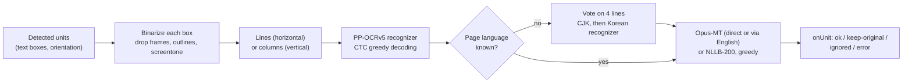
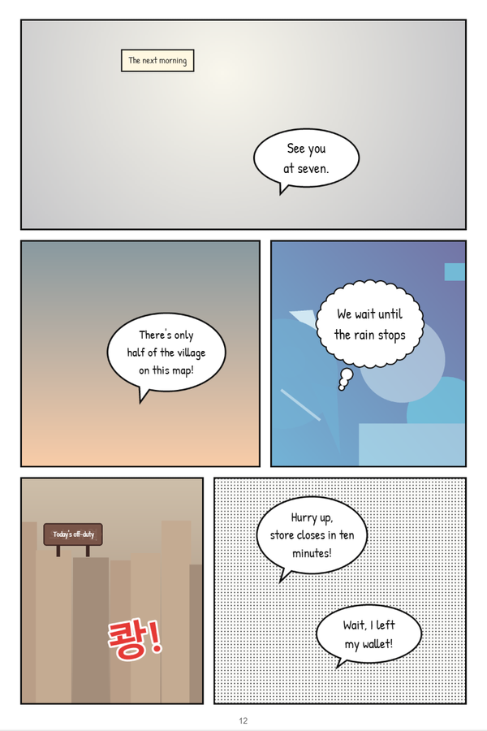
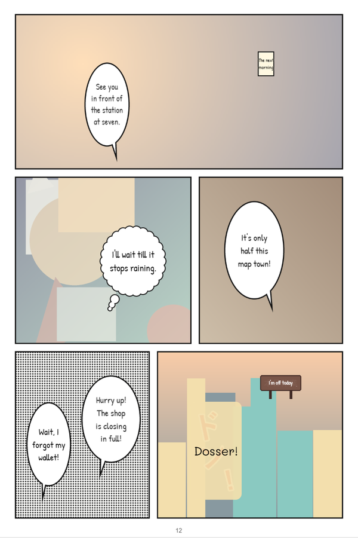

# Offline mode (experimental)

Offline mode translates comics **without any AI endpoint**. Open-source models run inside the extension's engine with
onnxruntime-web: a PaddleOCR recognizer reads the text the detector found, and a machine translation model (Opus-MT
or NLLB-200) translates it. Detection, erasing, lettering, the cache, the transcript and the glossary view are the
same as in the default mode. The goal is to let you judge whether this is good enough for you; it is clearly below a
vision model (see [the evaluation](#evaluation) and [the comparison](#compared-with-the-api-mode)).

The default stays the API mode (`translate.engine: "api"`), unchanged.

## Turning it on

1. Open **Options → Translation**.
2. Choose _Offline on this device (experimental)_ at the top. The endpoint form gives way to the offline card.
3. Pick the **Offline translation model**:
   - **Opus-MT** (default): one small model per language direction, about 115 MB each. Korean, Japanese, Chinese and
     Spanish are translated into English; English into Vietnamese, Spanish, French, German, Italian and Indonesian.
     Other pairs go through English (two models, about 230 MB). Pairs with no route (for example into Japanese,
     Korean, Chinese, Brazilian Portuguese, Filipino, Polish or Turkish) report "This language pair is not available
     offline".
   - **NLLB-200 600M**: one model for every pair of the target languages (about 910 MB). **Its licence, CC-BY-NC-4.0,
     allows non-commercial use only.**

These two settings are `translate.engine` and `translate.offlineModel` ([CONFIGURATION.md](CONFIGURATION.md)). The card also shows how much the downloaded models take on this device and can
delete them.

Nothing else needs to be set up: no endpoint, no key. In offline mode the extension never contacts the AI endpoint
(not even its `/models` check), and since nothing is uploaded, translation does not wait for the privacy notice.

## How it works



- **Recognition** (`src/shared/offline/ocr.ts`, `src/engine/offline/recognizer.ts`). Each text box of a unit is
  binarized with Otsu's threshold. The text class is the one made of small components (dark text in a balloon, light
  text on a dark sign); thin straight frame lines, ink reaching in from outside the box (balloon outlines) and
  screentone specks are removed. The layout is read from the ink (lines or columns, so a vertical Japanese balloon
  the detector called horizontal still reads right), then split with a projection profile. A horizontal line is
  resized to the recognizer's height (48 px, width ≥ 320, BGR, normalized to [-1, 1], as PaddleOCR does). A vertical
  column is cut into character cells laid side by side upright, which keeps small kana and punctuation that
  PaddleOCR's 90° rotation of tall crops loses. Lines run in batches sorted by width; the output is decoded greedily
  (best class per step, repeats collapsed, blanks dropped).
- **Recognizer per language.** Korean: `korean_PP-OCRv5_mobile_rec`; Japanese and Chinese: `PP-OCRv5_mobile_rec`;
  English: `en_PP-OCRv5_mobile_rec`; Spanish: `latin_PP-OCRv5_mobile_rec`. The language comes from the site settings,
  the series memory or the image record; when it is "auto", the four largest lines are read with the CJK recognizer
  (kana → Japanese, Han → Chinese, Latin → English or Spanish by accents and common words) and, if that is not
  convincing, with the Korean one. The result is stored like the API's `@lang` answer, so the next images skip the
  vote.
- **Translation** (`src/engine/offline/seq2seq.ts`, `src/shared/offline/tokenizer.ts`, `routing.ts`). The models are
  Hugging Face Optimum exports: an encoder and a merged decoder with a key/value cache. The tokenizer is implemented
  from `tokenizer.json` in TypeScript (SentencePiece Unigram for Marian, BPE with SentencePiece's precompiled
  normalizer for NLLB; special tokens never match text). Up to 8 units are translated per batch with greedy decoding
  (no repeated 4-gram, at most 3 × the source tokens + 10). All-capital Latin lettering is put in sentence case first,
  and a full stop is added to unpunctuated captions (and removed from the answer): without it Opus-MT can turn
  "The next morning" into a loop of one word. NLLB gets the source language code first and the target code as the
  forced first token (`kor_Hang`, `jpn_Jpan`, `zho_Hans`, `eng_Latn`, `spa_Latn` → `eng_Latn`, `vie_Latn`, ...).
- **Results.** A unit gets `ok` with its translation, `keep-original` when the translation equals the source, the
  text has no letters, the unit is a sound effect or the page is already in the target language, `ignored` for page
  numbers at the edge and boxes with nothing readable, and `error` when the pair is not supported or a model cannot be
  downloaded or run. Nothing is erased without a valid translation. The type comes from the geometry (balloon text is
  dialogue, free text with glyphs twice the median of its batch is a sound effect, other free text narration); the
  speaker is always empty. Sound effects keep their lettering: those typed by the geometry, and any text that is one
  short chunk written several times (두근두근, ドキドキ, ゴゴゴ), which a sentence model turns into nonsense (두근두근
  became "Two-by-two"). Other short sound effects are still translated, often badly: on the fixtures a misread ドン！
  became "Dosser!" and BOOM! "Đang chạy!" ("running"). A leading subtitle dash ("- I'm off today"), a habit of
  Opus-MT, is removed. Stored translations carry the engine in their model id (`offline:opus-mt-ko-en`,
  `offline:opus-mt-ja-en+opus-mt-en-vi`, `offline:nllb-200-distilled-600m`), so switching engine or offline model
  translates the page again.
- **Model delivery** (`src/engine/offline/model-store.ts`). Models are never bundled. On first use the engine
  downloads each file from `https://huggingface.co/<repo>/resolve/<revision>/<path>` at the commit pinned in
  `vendor/models.lock.json`, checks its size and SHA-256, and keeps it in Cache Storage (keyed by its hash). The popup
  shows the download progress. Afterwards translation works without a network; the hash is checked once and
  remembered in the `models` store. A damaged cached file is downloaded again.
- **Runtime.** The recognizers run in the engine's ORT instance, behind the lock the detector uses (asyncify allows
  one call at a time), on WebGPU when the detector does, else on WebAssembly. The int8 translation models run on
  WebAssembly (they were slower on WebGPU) in their own worker, `engine/offline-worker.js`, with its own ORT instance
  (see [Memory](#memory)). One pack translates at a time. Everything is released after `engine.detectorReleaseMin`
  without work.

## Memory

onnxruntime-web keeps every session of one instance in a single WebAssembly heap: at most 4 GiB (4.29 GB), and it
never shrinks. Measured with the pinned int8 exports, a translation model takes about 2.6× the size of its files
once loaded and up to 3.9× after its first batch: Opus-MT 0.3–0.4 GB, NLLB-200 3.4 GB.

Early builds ran the translation models in the detector's instance. With the detector, the recognizers and a pivot
pair loaded, adding NLLB-200 grew that heap to 3.8–4.0 GB (measured in Chrome 154 with a heap probe, and the same in
Node with the same ORT build). At that point any further growth (another model, a larger batch, the detector
reloading after its idle release) fails, ORT aborts, and the abort takes the detector and every later image down
with it: offline mode "crashed" the engine.

Now:

- **Separate heaps.** The translation models live in a dedicated worker with its own ORT instance. The engine's own
  heap (detector and recognizers) stays around 0.1 GB; the worker's holds only translation models.
- **A budget** (`src/engine/offline/memory.ts`). Before a pack loads its models, those it does not need are unloaded.
  The worker is restarted (terminating it gives its whole heap back) when NLLB-200 and Opus-MT would meet, or when a
  heap that already grew past 2 GB would be reused for another model. A pack whose models are estimated at more than
  3.8 GB is refused. NLLB-200 alone fits: in the stress run below its worker peaked at 3.4 GB, and switching back to
  Opus-MT restarted it at 0.35–0.45 GB.
- **One file at a time.** Model files are read and handed to the worker one by one (transferred, not copied), so the
  engine never holds both halves of NLLB-200 (0.9 GB) at once.
- **Failures stay per image.** Out of memory in the worker (a refused `Memory.grow`, an ORT abort) or a crashed
  worker fails the pack with `offline.out_of_memory` (or `offline.run`): its units become errors, nothing is erased,
  the worker is restarted and the next pack loads afresh. The popup shows the error with a hint to choose Opus-MT. A
  model that runs out of memory twice in a row is refused (without loading it again) until the offline models are
  released.

Stress run (test build, Chrome 154 headless, series memory off): five pages through four Opus-MT pairs into
Vietnamese, NLLB-200 on a Korean page, then Opus-MT into English on two more pages. The engine document never
restarted; the engine's heap stayed at 107 MB throughout; the worker's heap went 0.64 → 0.77 GB (Opus-MT), 3.43 GB
(NLLB-200), then 0.45–0.54 GB after the restart. `e2e/offline-memory.e2e.ts` checks the same path.

## Models

All files are pinned to a commit and a SHA-256 in the `offline` group of
[`vendor/models.lock.json`](../vendor/models.lock.json) and used unmodified.

| Model id                  | Repository (pinned commit)                                                                                                                                                   | Files                                                                                               | MB    | License          |
| ------------------------- | ---------------------------------------------------------------------------------------------------------------------------------------------------------------------------- | --------------------------------------------------------------------------------------------------- | ----- | ---------------- |
| `ocr-korean`              | [PaddlePaddle/korean_PP-OCRv5_mobile_rec_onnx](https://huggingface.co/PaddlePaddle/korean_PP-OCRv5_mobile_rec_onnx/tree/5c6f574b8e2230adf4287b33e736d71b9fabd28e) `5c6f574b` | `inference.onnx`, `inference.yml` (dictionary)                                                      | 13.5  | Apache-2.0       |
| `ocr-cjk`                 | [PaddlePaddle/PP-OCRv5_mobile_rec_onnx](https://huggingface.co/PaddlePaddle/PP-OCRv5_mobile_rec_onnx/tree/ed152b8b495f84de93cda5709d768548a9127622) `ed152b8b`               | same                                                                                                | 16.7  | Apache-2.0       |
| `ocr-latin`               | [PaddlePaddle/latin_PP-OCRv5_mobile_rec_onnx](https://huggingface.co/PaddlePaddle/latin_PP-OCRv5_mobile_rec_onnx/tree/89d3a50e2c27e2e7cceeab0e944c25c807d5db4f) `89d3a50e`   | same                                                                                                | 8.0   | Apache-2.0       |
| `ocr-en`                  | [PaddlePaddle/en_PP-OCRv5_mobile_rec_onnx](https://huggingface.co/PaddlePaddle/en_PP-OCRv5_mobile_rec_onnx/tree/3fafbc3b5dcf93dd72add9f48368be8a3a2cd33b) `3fafbc3b`         | same                                                                                                | 7.9   | Apache-2.0       |
| `opus-mt-ko-en`           | [Xenova/opus-mt-ko-en](https://huggingface.co/Xenova/opus-mt-ko-en/tree/d9fa1ac6008242100fecb4fff9b0a5917a1be81f) `d9fa1ac6`                                                 | `encoder_model_quantized`, `decoder_model_merged_quantized` (int8), `tokenizer.json`, `config.json` | 119.6 | Apache-2.0       |
| `opus-mt-ja-en`           | [Xenova/opus-mt-ja-en](https://huggingface.co/Xenova/opus-mt-ja-en/tree/1a906cfaaf7c8f4193f67f5885c082aa6dbd9d16) `1a906cfa`                                                 | same                                                                                                | 114.7 | Apache-2.0       |
| `opus-mt-zh-en`           | [Xenova/opus-mt-zh-en](https://huggingface.co/Xenova/opus-mt-zh-en/tree/39d480d52a9ea3065a1f117adfe4dbc55de10e6f) `39d480d5`                                                 | same                                                                                                | 119.5 | CC-BY-4.0        |
| `opus-mt-es-en`           | [Xenova/opus-mt-es-en](https://huggingface.co/Xenova/opus-mt-es-en/tree/eadfd7c658a9d8929ac3b8e996b68a68e2c7d480) `eadfd7c6`                                                 | same                                                                                                | 119.4 | Apache-2.0       |
| `opus-mt-en-vi`           | [Xenova/opus-mt-en-vi](https://huggingface.co/Xenova/opus-mt-en-vi/tree/30bcd461c0d7338ad106b36314d3eedc2d4e998c) `30bcd461`                                                 | same                                                                                                | 106.6 | Apache-2.0       |
| `opus-mt-en-es`           | [Xenova/opus-mt-en-es](https://huggingface.co/Xenova/opus-mt-en-es/tree/4b002a4c7edd54a7ced58877258b87f7efd3f892) `4b002a4c`                                                 | same                                                                                                | 119.4 | Apache-2.0       |
| `opus-mt-en-fr`           | [Xenova/opus-mt-en-fr](https://huggingface.co/Xenova/opus-mt-en-fr/tree/28726206f80896b90035bd99cccd5cc1e151f916) `28726206`                                                 | same                                                                                                | 113.1 | Apache-2.0       |
| `opus-mt-en-de`           | [Xenova/opus-mt-en-de](https://huggingface.co/Xenova/opus-mt-en-de/tree/1ca130c44c4c5441ef16d48aae521a424ab644f7) `1ca130c4`                                                 | same                                                                                                | 111.5 | CC-BY-4.0        |
| `opus-mt-en-it`           | [Xenova/opus-mt-en-it](https://huggingface.co/Xenova/opus-mt-en-it/tree/075406e3c8c2c30634d4a1bd8f00c21d9e162011) `075406e3`                                                 | same                                                                                                | 136.5 | Apache-2.0       |
| `opus-mt-en-id`           | [Xenova/opus-mt-en-id](https://huggingface.co/Xenova/opus-mt-en-id/tree/b3b41f654c2fb3286d007dee1da7b0f47fd27d82) `b3b41f65`                                                 | same                                                                                                | 107.9 | Apache-2.0       |
| `nllb-200-distilled-600m` | [Xenova/nllb-200-distilled-600M](https://huggingface.co/Xenova/nllb-200-distilled-600M/tree/261c31d1a5732c67cdd16d80e8d6088507c7ccea) `261c31d1`                             | same (int8 quantized)                                                                               | 912.0 | **CC-BY-NC-4.0** |

What a page costs to download the first time (recognizers, the language vote's included, plus the translation
models): Korean → English 150 MB, Japanese → English 131 MB, Chinese → English 136 MB, Spanish → English 144 MB,
English → Vietnamese 131 MB, Korean/Japanese/Chinese/Spanish → Vietnamese through English 238–256 MB, any pair with
NLLB-200 about 930–945 MB. Setting the site's source language skips the vote (and its second recognizer).

## Evaluation

`tools/offline-eval/run.ts` runs the offline pipeline in Chrome through the E2E harness (onnxruntime-node is not a
dependency, so nothing runs in Node): a test build translates the generated fixtures with `translate.engine:
"offline"`, the models come from a local mirror of `.cache/offline-models`, and the mock API server must see no
request (it saw none). Per page it pairs ground-truth units with the engine's units by geometry and reports:

- **OCR CER**: character error rate of the recognized text against the ground truth's `original` (graphemes; spaces
  and punctuation ignored, case folded). A ground-truth unit the detector did not find counts as 1. Page numbers are
  left out.
- **chrF** (0–100, character 6-grams, β = 2, case-insensitive): the translation against the reference. For English,
  the reference is the parallel English line of the fixture (`test/fixtures/sentences/en.json`); for Vietnamese, the
  ground truth's `vi`. Each line has one reference, so a correct paraphrase scores low; read the samples too.
- **Time per unit**: detection (from the engine log), OCR and translation (from the offline translator's log), with
  the detector (and so the recognizer) on WebGPU (`auto`) or forced to WebAssembly (`wasm`); "warm" leaves out the
  first page of each run, which downloads and loads the models.

Setup: Chrome 154 headless, Intel Core i5-11500 (6 cores; onnxruntime-web uses 1 thread), NVIDIA GeForce RTX 2060,
Windows 11, test build of this commit, site source language "auto" (the vote runs), series memory off (every fixture
page is on the same test site). Raw results: `reports/offline-eval/` (not committed).

### OCR

Same on every run of the `auto` backend (Opus-MT and NLLB-200 share the recognition):

| Page         | Language | Units (detected) | CER   | CER, detected units | Notes                                                                      |
| ------------ | -------- | ---------------- | ----- | ------------------- | -------------------------------------------------------------------------- |
| `ko-p01`     | ko       | 8 (7)            | 0.125 | 0.000               | the sound effect 쾅! is not detected                                       |
| `ja-p01`     | ja       | 8 (8)            | 0.125 | 0.125               | vertical text read exactly; the stylized sound effect ドン！ reads ドソー! |
| `zh-p01`     | zh       | 8 (7)            | 0.125 | 0.000               | the sound effect 轰！ is not detected                                      |
| `en-p01`     | en       | 8 (8)            | 0.000 | 0.000               |                                                                            |
| `es-p01`     | es       | 8 (8)            | 0.000 | 0.000               | ¡ is read as i and restored                                                |
| `ko-strip01` | ko       | 17 (17)          | 0.015 | 0.015               | 껐던가 → 겠던가, 놨어 → 났어                                               |

With everything on WebAssembly the detector finds slightly different boxes: `ja-p01` loses ドン！ (not detected) and
`ko-strip01` reads 두근두근 as 근두근 (CER 0.030). Punctuation is not scored, but it is sometimes lost: the ellipsis of
비가 그칠 때까지 기다릴까… and the comma of この地図、町の半分… were not read, which changes their translations.

On these clean synthetic pages the recognizers are nearly perfect once a unit is found; what is missed is the
detector's (large stylized sound effects) or stylized lettering itself. Real scans with noise, textured balloons,
handwritten or tilted lettering will do worse.

### Translation

chrF against the reference (0–100; `auto` backend; Opus-MT into Vietnamese goes through English except from English):

| Page         | Opus-MT → en | NLLB-200 → en | Opus-MT → vi | NLLB-200 → vi |
| ------------ | ------------ | ------------- | ------------ | ------------- |
| `ko-p01`     | 50.7         | 56.9          | 44.6         | 44.6          |
| `ja-p01`     | 54.4         | 52.5          | 41.2         | 43.6          |
| `zh-p01`     | 54.0         | 65.3          | 54.2         | 49.9          |
| `en-p01`     | 100 (kept)   | 100 (kept)    | 42.4         | 42.0          |
| `es-p01`     | 69.4         | 68.8          | 37.2         | 39.6          |
| `ko-strip01` | 57.3         | 47.9          | 37.7         | 31.2          |

The `wasm` run of Opus-MT scored 62.5 for `ja-p01` → en, 79.1 for `es-p01` → en and 48.3 for `ja-p01` → vi from the
same recognized text: the units were batched differently, padding changes the int8 arithmetic slightly, and greedy
decoding then picks other words ("See you in front of the station at seven." vs "I'll meet you in front of the
station at seven."). With 8 lines per page, differences of up to ten points are noise.

Samples into English (recognized text; the reference is the fixture's English line):

| Source (recognized)                   | Opus-MT                                                  | NLLB-200                                                  | Reference                                   |
| ------------------------------------- | -------------------------------------------------------- | --------------------------------------------------------- | ------------------------------------------- |
| 다음 날 아침                          | The next morning                                         | The next morning                                          | The next morning                            |
| 일곱 시에 역 앞에서 보자.             | See you at seven.                                        | I'll see you at the station at seven.                     | See you in front of the station at seven.   |
| 이 지도엔 마을 절반밖에 없잖아!       | There's only half of the village on this map!            | There's only half the town on this map!                   | This map only shows half the town!          |
| 비가 그칠 때까지 기다릴까             | We wait until the rain stops                             | I'll wait until it rains                                  | Maybe I should wait for the rain to stop... |
| 오늘 휴업 (sign)                      | Today's off-duty                                         | Today's the day off                                       | Closed today                                |
| 七時に駅の前で会おう。                | See you in front of the station at seven.                | I'll meet you at the station at 7:00.                     | See you in front of the station at seven.   |
| この地図町の半分しか載ってないよ!     | It's only half this map town!                            | This map only shows half the town!                        | This map only shows half the town!          |
| 急いで店があと十分で閉まるよ!         | Hurry up! The shop is closing in full!                   | Hurry up, the store's gonna be shutting down soon enough! | Hurry, the shop closes in ten minutes!      |
| ドソー! (ドン！ misread)              | Dosser!                                                  | Dozor, what are you doing?                                | Boom!                                       |
| 这张地图只画了半个小镇！              | This map only paints half a town!                        | This map only shows half the town!                        | This map only shows half the town!          |
| 要不等雨停了再走吧……                  | Why don't you wait until the rain stops and you're gone? | Don't wait until it stops raining and leave.              | Maybe I should wait for the rain to stop... |
| ¿Y SI ESPERO A QUE DEJE DE LLOVER...? | What if I wait till it stops raining?                    | What if I wait until it stops raining?                    | Maybe I should wait for the rain to stop... |
| A LA MAÑANA SIGUIENTE                 | The next morning                                         | I'll see you the next morning                             | The next morning                            |
| 상자는 내가 들게. 너는 문 좀 열어 줘. | I'll take the box. You can open the door.                | I'll hear the box. You open the door.                     | I'll carry the boxes. You get the door.     |
| 그 우산은 내 거 아니야.               | That umbrella is not mine.                               | That's not my cage.                                       | That umbrella isn't mine.                   |
| 가스 불은 겠던가? (껐 misread)        | Gas fire?                                                | You mean the gas flame?                                   | Did I turn off the stove?                   |
| 똑똑 (sound effect)                   | Knock, knock                                             | You're smart                                              | Knock knock                                 |
| 두근두근 (sound effect)               | kept as drawn                                            | kept as drawn                                             | Ba-dump                                     |

Samples into Vietnamese (the reference is the fixture's ground truth):

| Source (recognized)                         | Opus-MT                                                        | NLLB-200                                              | Reference                                       |
| ------------------------------------------- | -------------------------------------------------------------- | ----------------------------------------------------- | ----------------------------------------------- |
| 잠깐, 지갑을 두고 왔어!                     | Khoan, tôi quên ví rồi!                                        | Chờ chút, tôi để lại ví của tôi!                      | Khoan đã, mình quên ví rồi!                     |
| 七時に駅の前で会おう。                      | Gặp lại anh ở ga số 7. ("see you at station number 7")         | Tôi sẽ gặp anh ở trước trạm lúc 7 giờ.                | Bảy giờ gặp nhau trước nhà ga nhé.              |
| 这张地图只画了半个小镇！                    | Bản đồ này chỉ có thể bán được nửa thị trấn! ("can only sell") | Bản đồ này chỉ mô tả một nửa thị trấn!                | Tấm bản đồ này chỉ có một nửa thị trấn thôi!    |
| MAYBE I SHOULD WAIT FOR THE RAIN TO STOP... | Có lẽ tôi nên đợi trời mưa... ("wait for it to rain")          | Có lẽ tôi nên đợi cho mưa dừng lại...                 | Hay là đợi mưa tạnh rồi hẵng đi…                |
| ¡CORRE, LA TIENDA CIERRA EN DIEZ MINUTOS!   | Chạy đi, cửa hàng sẽ đóng cửa trong 10 phút nữa!               | Đi đi, cửa hàng đóng cửa trong 10 phút!               | Nhanh lên, mười phút nữa cửa hàng đóng cửa rồi! |
| 뒷문은 잠갔어?                              | Cửa sau có khóa không?                                         | Cổng sau bị ngập không? ("is the back gate flooded?") | Cậu khóa cửa sau chưa?                          |
| 이번엔 반반씩 내자.                         | Đã quá nửa thời gian rồi. ("half the time has passed")         | Lần này, chúng ta sẽ đặt một nửa.                     | Lần này chia đôi tiền nhé.                      |

In short: plain dialogue usually comes out right or close in English; short, elliptical or colloquial lines (signs,
thoughts, sound effects, "let's split the bill") are often wrong. NLLB-200 does better on Chinese and on some full
sentences but invents more (a "cage" for an umbrella; in Vietnamese it dropped the second sentence of 상자는 내가
들게. 너는 문 좀 열어 줘.). Vietnamese is weaker with both models, defaults to "tôi/anh" and loses the casual tone.

### Speed

Time per unit in milliseconds, warm (the first page of each run, which downloads and loads the models, left out); a
1200 × 1800 page has 7–9 units:

| Model, backend                          | Detection | OCR | Translation | Language vote | First load (local mirror: download, hash, sessions) | Page, wall clock |
| --------------------------------------- | --------- | --- | ----------- | ------------- | --------------------------------------------------- | ---------------- |
| Opus-MT, `auto` (WebGPU detection, OCR) | 228       | 52  | 345         | 20            | 4.8 s                                               | 5.6 s            |
| Opus-MT, `wasm` (everything on the CPU) | 303       | 267 | 265         | 46            | 5.1 s                                               | 8.7 s            |
| NLLB-200, `auto`                        | 204       | 49  | 2134        | 16            | 29.3 s                                              | 14.5 s           |

Translation dominates: Opus-MT needs about a quarter to a third of a second per balloon on one CPU thread, NLLB-200
1.5 to 2 seconds (an earlier run on the same machine measured 1.6 s per unit and 11.3 s per page). Two packs run at
once and share the engine's single ORT lock, which is why the per-unit translation time on `auto` is not lower than
on `wasm`. The download from Hugging Face itself is not part of these numbers (the mirror is local); on a 50 Mbit/s
line the first Korean → English page adds about 25 s, NLLB-200 about 2.5 min.

## Screenshots

`ko-p01` and the vertical Japanese `ja-p01` translated into English with Opus-MT (`auto` backend), no AI endpoint.
Compare with the API mode's [`after.png`](images/after.png). On `ko-p01` the sound effect 쾅! was not detected and
stays as drawn; on `ja-p01` the misread ドン！ became "Dosser!" over a pale patch, and the narrow vertical caption
"The next morning" is lettered small.





## Known limitations

- **Quality.** Sentence-by-sentence machine translation without the image: no context between balloons, no speaker
  or tone, no character names from the glossary, literal or wrong readings of short and elliptical lines ("Today's
  off-duty" for a closed sign, "Gas fire?" for "did I turn off the stove?"). Through English, errors of both legs add
  up, and Vietnamese pronouns default to "tôi/anh".
- **Sound effects.** Large stylized ones are often not detected or misread; the ones recognized as sound effects
  are left as drawn and the others are translated word for word (see Results above). A free caption with very large
  letters can be mistaken for a sound effect and stay untranslated.
- **Glossary and series memory** are not used by the offline engine (no term suggestions, no summary); manual edits
  and the transcript work as usual.
- **Language pairs.** Opus-MT covers into-English for the five source languages and English into six targets; CJK,
  Korean, Brazilian Portuguese, Filipino, Polish and Turkish targets need NLLB-200. NLLB-200 is non-commercial only.
- **Speed and memory.** Everything runs on one CPU thread (the extension has no cross-origin isolation for threads),
  NLLB-200 takes over a second per balloon and about 3.4 GB of memory in its worker while loaded (released after
  `engine.detectorReleaseMin` idle); on a machine short of memory, choose Opus-MT. Switching between NLLB-200 and
  Opus-MT reloads the models (about 10 s for NLLB-200). The first use downloads 130–260 MB (Opus-MT) or about 930 MB
  (NLLB-200).
- **Recognition.** Lines and columns are found from projection profiles: tilted, curved or overlapping lettering,
  text over busy art and mixed horizontal/vertical blocks can be split wrongly. The recognizers are the mobile
  PP-OCRv5 ones (small, fast, less accurate than the server variants).
- **Vertical Japanese** is read as upright character cells; vertical-only glyphs are approximated (the vertical
  ellipsis and the long-vowel bar are fixed up).
- **Not tuned on real comics.** The numbers above come from the synthetic fixtures; expect lower OCR accuracy on real
  scans.

## Compared with the API mode

| Aspect         | API mode (vision model)                                                                | Offline mode                                                   |
| -------------- | -------------------------------------------------------------------------------------- | -------------------------------------------------------------- |
| Reads the text | the model reads the crops itself, stylized lettering and sound effects included        | PP-OCRv5 per line; clean lettering only                        |
| Translates     | with the page in view: context, tone, speakers, glossary, earlier lines, story summary | each balloon alone, literally                                  |
| Line types     | from the model (dialogue, thought, narration, sign, sfx)                               | guessed from the geometry                                      |
| Privacy        | composites of the text regions go to your endpoint                                     | nothing leaves the device (the models are downloaded once)     |
| Cost and setup | an endpoint and a key, or a local vision model server                                  | none; 130–260 MB (Opus-MT) or about 930 MB (NLLB-200) once     |
| Speed per page | the endpoint's latency, streamed balloon by balloon                                    | 6–9 s with Opus-MT, 11–15 s with NLLB-200 (this machine, warm) |

This evaluation measured offline mode only; the E2E suite checks the API mode against a mock server, so there is no
like-for-like quality number for a real vision model here. From the samples above, offline mode gets the gist of most
lines and loses nuance, register and names on many, and short or elliptical lines (signs, sound effects, thoughts)
are where it fails most. It is a fallback for when no endpoint is available or nothing may leave the device, not a
replacement for the API mode.

## For developers

```sh
npm run fetch-models -- --offline              # all offline models (~2.1 GB) into .cache/offline-models
npm run fetch-models -- --offline=ocr-korean,ocr-cjk,opus-mt-ko-en   # just what the E2E test needs
node scripts/build.ts --test --out=build-offline
CTV_EXTENSION_DIR=build-offline node --test --test-concurrency=1 --test-timeout=600000 e2e/offline.e2e.ts
CTV_EXTENSION_DIR=build-offline npm run eval:offline -- --models=opus-mt --backends=auto,wasm --targets=en,vi
```

- In development and test builds `debug.offlineModelBaseUrl` replaces `https://huggingface.co` (same
  `<repo>/resolve/<revision>/<path>` layout), and its origin is let through the SSRF guard. Production builds ignore
  it. `e2e/helpers/offline-models.ts` serves the pinned files from `.cache/offline-models`.
- `e2e/offline.e2e.ts` is skipped (with the command above) when the models are not cached, so CI stays green.
- Unit tests cover the tokenizer (synthetic `tokenizer.json` fixtures in `test/fixtures/offline/`, and the real files
  when cached), CTC decoding, segmentation, routing, settings, the model store (fake fetch and cache) and the offline
  translator against fake ORT sessions.
